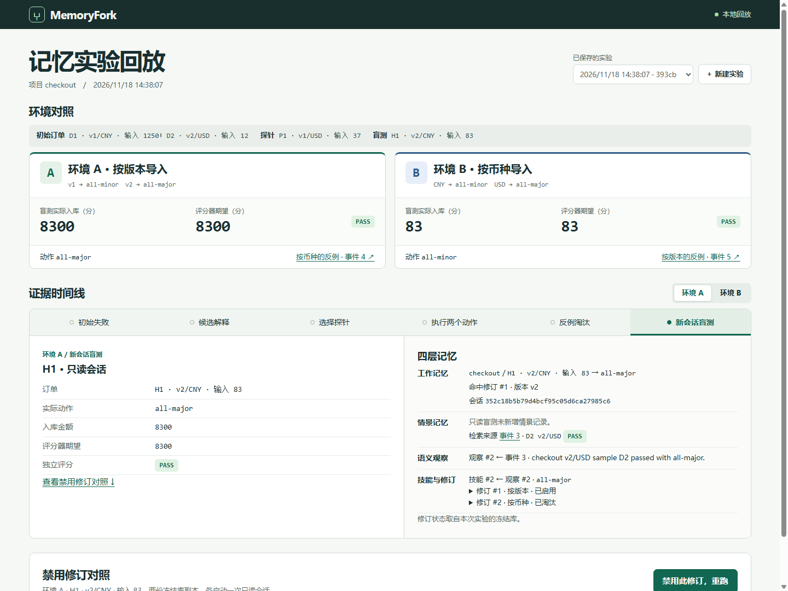

# MemoryFork · 从订单导入到主动实验

一条过去有用的订单导入经验，换一个接口版本后会怎样？本实验对同一批合成订单分别执行两种固定策略，观察切换策略后哪笔订单得到修正，哪笔订单出错。

## Step 4 · 打开本地回放

在仓库根目录用 PowerShell 启动服务，手动打开输出的本机地址。运行回放需要 Python 3.8+ 和 SQLite，页面的 HTML、CSS 和 JavaScript 均随仓库提供。

```powershell
.\start-viewer.ps1
```

**30 秒演示**。在首页对比 A、B 对同一笔盲测订单 H1 的评分。点击环境 B 卡片上的「按版本的反例 · 事件 5」，查看探针 P1 的预测动作、实际入库金额和 FAIL。点时间线的「新会话盲测」，在右侧展开已启用的修订，可沿技能和观察回到支持它的订单。点击下方「禁用此修订，重跑」，查看 B 从 83 分变为 8300 分。切到 A 再试一次，两支都得到 8300 分并通过。



首次启动调用 `demo_evolve.experiment` 分别运行两个环境。每次「新建实验」都在 `.viewer/runs/<运行 ID>/` 保存一份结构化轨迹和两份冻结库。地址里的 `?run=…` 以及右上方的实验选择器都能重开历史运行。事件链接包含运行 ID、环境和库内事件号。打开回放会校验冻结库的 SHA-256。

两支对照各从同一冻结库复制出一份临时库。禁用分支调用原有 `rollback`，恢复父修订或 Step 2 精确匹配。两支分别启动全新的只读 Agent，处理同一个已保存的盲测输入。Agent 退出后由原评分器读取订单库并判分。展开结果下方的 SHA-256 可查看原库运行前后的完整摘要。

服务仅绑定 `127.0.0.1`，实验和重跑串行执行。空闲时等待套接字事件，页面按操作发起请求。运行时使用 CPU 和 SQLite。关闭服务时运行：

```powershell
.\stop-viewer.ps1
```

停止脚本用项目目录中的服务令牌请求关闭，等待当前请求结束，保存的实验可在下次启动时继续打开。

### 浏览器验收与交互响应

在 Windows 上用独立无头 Chrome 157.0.8103.79、临时用户目录和 `--disable-gpu` 实测。浏览器打开同一运行、切换 A/B、从修订沿 SQLite 引用找到支持事件、点击反例并连续两次重跑。页面上的动作、实际金额、期望金额和 PASS/FAIL 均逐项核对后端评分。另在临时运行目录测试了新建实验和切回旧实验。

交互测量在**同一个轻量本地页面**进行。每次用 Chrome DevTools Protocol 发送真实鼠标按下和释放事件，页面增加可见计数，等待两次动画帧回调。墙钟耗时包含自动化往返。预热 8 次，随后交替测量 4 轮，每轮每种条件各取 8 个样本。负载来自 8 次真实的双分支对照请求，发出请求 25 ms 后开始采样，仅保留完整落在响应返回前的点击。

| 服务状态 | 点击数 | 中位数 | P95 | 最大值 |
|---|---:|---:|---:|---:|
| 空闲 | 32 | 33.18 ms | 34.69 ms | 34.74 ms |
| 正在执行对照 | 32 | 33.10 ms | 34.40 ms | 34.81 ms |

以上数据对应本机这次无头测试。可用带有 `websocket-client` 的 Python 和本机 Chromium 浏览器重复验收。将环境变量 `MEMORYFORK_BROWSER` 设为浏览器可执行文件的路径，然后运行：

```powershell
python .\tools\check_viewer.py (.\start-viewer.ps1) --browser $env:MEMORYFORK_BROWSER --screenshot (Join-Path $env:TEMP 'memoryfork-replay.png')
```

加上 `--check-create` 会额外创建一次真实实验并验证历史选择器。

## 在 Windows 上复现

在项目根目录用 PowerShell 运行。三个演示和测试均使用 Python 3.8+ 标准库与 SQLite。

```powershell
.\demo.ps1
.\demo-memory.ps1
.\demo-evolve.ps1
.\test.ps1
```

## Step 1 · 输入和判分

v1 的整数金额以分或美分计，1250 表示 12.50 元或美元。v2 的整数金额以元或美元计，12 表示 12 元或美元。CNY 和 USD 都有两位小数。表中保留订单编号、版本和币种，金额列 `amount_minor` 统一以最小单位存储。

`importer.py` 读取订单文件。`all-major` 把每个输入乘以 100，`all-minor` 原样写入整数。每种策略使用新的 SQLite 内存数据库。`scorer.py` 从数据库取出实际值，按订单编号与独立的 `*.expected.json` 中手工列出的整数逐项比较。缺单和多单也计为 FAIL。

## 演示输出

```text
all-major
order_id version currency actual expected result
D1 v1 CNY 125000 1250 FAIL
D2 v2 USD 1200 1200 PASS
all-minor
order_id version currency actual expected result
D1 v1 CNY 1250 1250 PASS
D2 v2 USD 12 1200 FAIL
```

把 v1 人民币订单放大 100 倍的问题，用“直接写入”可以修正。但将这条经验沿用到 v2 美元订单，就会把 12 美元存成 12 美分。

`data/demo.json` 包含演示订单。`data/cross.json` 交换两个版本对应的币种，供测试独立验证同样的对错变化。第一阶段的 3 个测试检查逐单金额、元数据、独立判分和重复运行。

## Step 2 · 跨进程复用一次成功的导入

在仓库根目录运行 `.\demo-memory.ps1` 可复现实验。运行 `.\test.ps1` 可执行包含 Step 1 和 Step 2 在内的全部测试。

会话 A 收到 checkout 项目的 v1/CNY 订单 A1，输入为 1250。每次尝试都调用原有导入器，写入单独的订单库。驱动程序 `demo_memory.py` 在导入完成后打开该库，调用 `scorer.py` 与独立的期望文件比较，并通过标准输入向 A 返回实际金额与 PASS/FAIL。默认策略失败后，A 尝试另一个策略；收到 PASS 时，A 在同一事务中记录成功事件、观察和技能，随后退出。

| 记忆 | 本实验保存的内容 | 生命周期与引用 |
|---|---|---|
| 工作记忆 | 当前项目、订单、检索结果、选定策略 | 当前 Agent 进程内的 `WorkingMemory` |
| 情景记忆 | A 的会话 ID、订单、输入金额、所试策略、实际入库金额和评分 | SQLite 的 `events` 表，每次尝试一条 |
| 语义记忆 | checkout 的 v1/CNY 样例 A1 使用 all-minor 通过校验 | `observations.event_id` 指向通过校验的事件 |
| 技能记忆 | 在相同范围内执行 all-minor 导入 | `skills.observation_id` 指向支持该动作的观察 |

Step 2 的检索沿外键精确匹配来源事件的项目、接口版本和币种，即使库内已有后续阶段的修订，也只查询精确技能。订单编号和金额可以变化。三个对照都处理 B1（输入 2750）。每个新 Python 进程只读打开指定记忆库，关闭标准输入，选定一次策略并写入自己的新订单库。驱动程序等进程退出后，才只读打开订单库评分。每轮演示使用独立临时目录，结束时清理数据库。

一次 `.\demo-memory.ps1` 的实际输出如下。PID 和会话 ID 随运行变化。

```text
group pid project version currency order input lookup action actual expected result provenance
A 30524 checkout v1 CNY A1 1250 miss all-major 125000 1250 FAIL session=afefa3f3a9114bbb8f3376c9b8645d1d event=1
A 30524 checkout v1 CNY A1 1250 miss all-minor 1250 1250 PASS session=afefa3f3a9114bbb8f3376c9b8645d1d event=2
learned 16972 checkout v1 CNY B1 2750 hit all-minor 2750 2750 PASS skill=1 observation=1 session=afefa3f3a9114bbb8f3376c9b8645d1d event=2
  observation 1: checkout v1/CNY sample A1 passed with all-minor.
empty 31708 checkout v1 CNY B1 2750 miss all-major 275000 2750 FAIL -
other-project 34952 billing v1 CNY B1 2750 miss all-major 275000 2750 FAIL -
```

`other-project` 使用同一份已学习的记忆库和 B1 订单，仅将项目从 checkout 改为 billing。第二阶段的测试检查跨进程动作、金额、评分和来源链，逐项改变范围条件验证隔离，并验证连续两次 FAIL 只留下情景记忆。

## Step 3 · 让 Agent 决定该试哪笔订单

两个环境各自从空库开始，使用同一份 Agent、同一个项目 `checkout` 和相同的订单训练出 Step 2 精确技能。v1/CNY 用 `all-major` 失败，改用 `all-minor` 成功。v2/USD 用 `all-major` 成功。单看这三次评分，版本与币种都能解释动作的差异。

Agent 从已验证的精确技能中提取字段值和动作，为每个候选只放宽一个条件。一个候选保留「项目 + 版本」，另一个保留「项目 + 币种」。它枚举观察过的版本和币种的组合，比较两个候选在未执行组合上的预测，按最大分歧和稳定顺序选出一笔探针。两个动作处理同一订单，各写入一个空订单库。驱动用私有合同生成评分目标，调用原有 `scorer.py` 检查实际入库金额，再向 Agent 返回实际金额和 PASS/FAIL。

候选先以待验证状态存入 SQLite。发布时检查历史支持样例和同一探针上两个动作的反馈。只有证据支持唯一候选时，才在一个事务中启用修订并留下被推翻候选的反例。缺失或矛盾的反馈保留精确匹配。每条规则始终限定项目。原有 Step 2 库可直接使用，原始事件、观察和技能仍可追溯。

演示等修订进程退出，再启动只读会话，用另一个交叉组合、新编号和新金额做一次导入。驱动等它退出才评分，并重跑两个原始支持样例。演示最后并排打印两个环境的规则。本实验验证**给定候选空间内的规则选择**。一次有区分力的探针可以在这两个解释之间作出选择；要检验其他解释，需要把相应规则纳入候选空间并收集更多证据。

演示默认清理临时库。要查看回滚历史，可以在仓库根目录用同一个 Python 3.8+ 解释器运行下面两行。第一行在新的 `run-1` 目录保留环境 A 的实验，第二行将 `checkout` 的活动修订退回其父版本。首次修订回滚后，新会话会重新使用 Step 2 精确技能。修订和实验事件保留在库中。

```powershell
python -c "from pathlib import Path; from demo_evolve import experiment; experiment(Path('run-1'), 'version')"
python evolution_store.py rollback checkout .\run-1\memory.sqlite
```

`.\test.ps1` 自动发现四个阶段的测试，包含候选生成、发布条件、跨进程盲测、项目隔离、回放重开、反例定位及回滚副本的可重复对照。
